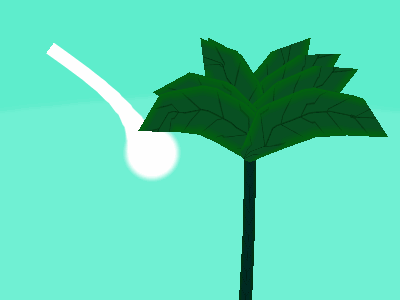
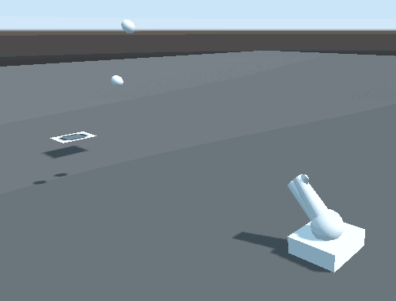
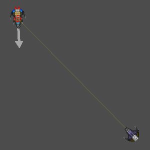
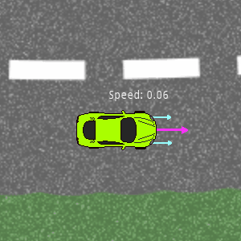

# GodotCon
Repository contains mine presentation and code demonstrated on GodotCon since 2018.

*Powered by [Godot Engine](https://godotengine.org)*

## Presentations:
Presentation with animations as a .pptx and static as .pdf:

## Projects:
### [Planet Shaders](https://github.com/JohnMeadow1/Enterprise-space-shaders/)

### [position_based_dynamics](/source/position_based_dynamics)
Finding targeting solution for parabolic motion:

### [balistics_3d](/source/projectile_motion_3d)
Finding targeting solution for parabolic motion:

### [spaceships_2d](/source/spaceships_2d) and [projectile_motion_2d](/source/projectile_motion_2d)
Finding targeting solution using approximation and quadratic equation:

### [drift_2d](/source/drift_2d)
Example of drift implementation including drawing of skid marks.

